

<a href="https://codeleap.co.uk/team/kenzo/"></a>

 

I work AI-first: AI agents draft, build and test features, and I check every step. For clients, that means every feature arrives with proof that it works: tests and a screen recording. I also build the AI tooling the CodeLeap team uses to work this way.

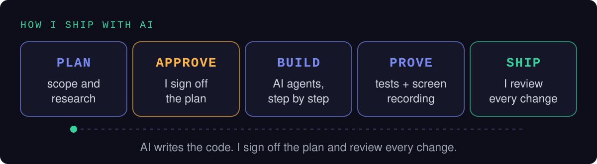

 

<a href="https://codeleap.co.uk/">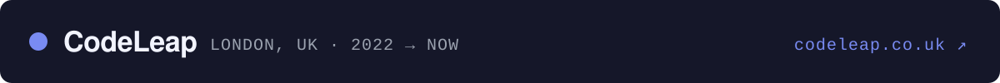</a>

The code lives in private client repositories, so here is what it shipped. Every card opens the full case study.

<table>
<tr>
<td width="50%" valign="top">
<a href="https://codeleap.co.uk/portfolio/outdoor-adventure-guide-app/">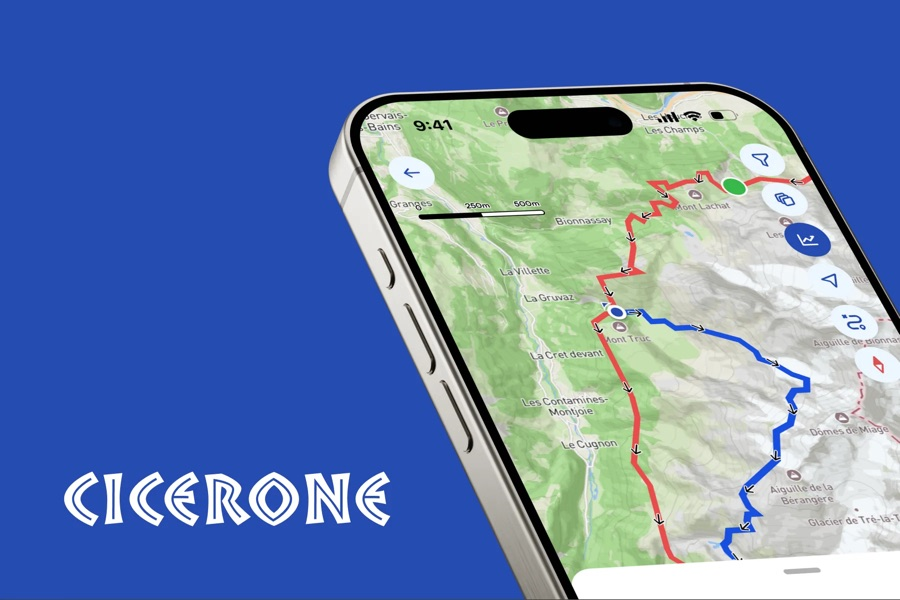</a>
 <code>OUTDOOR PUBLISHING</code> &nbsp;<b>Tech Lead</b>
<h3><a href="https://codeleap.co.uk/portfolio/outdoor-adventure-guide-app/">Cicerone</a></h3>
450+ walking guidebooks as interactive routes, with offline maps, in-app purchases and a Shopify hub.
</td>
<td width="50%" valign="top">
<a href="https://codeleap.co.uk/portfolio/frontline-chat-calling-app/">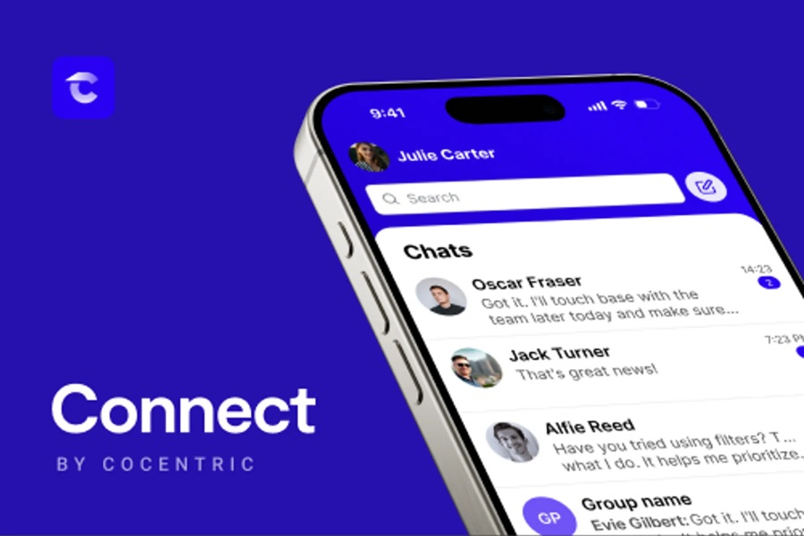</a>
 <code>WORKFORCE COMMS</code> &nbsp;<b>Tech Lead</b>
<h3><a href="https://codeleap.co.uk/portfolio/frontline-chat-calling-app/">Connect by CoCentric</a></h3>
Chat, voice and video for frontline workers, plus a white-label design system.
</td>
</tr>
<tr>
<td width="50%" valign="top">
<a href="https://codeleap.co.uk/portfolio/running-routes-races-app/">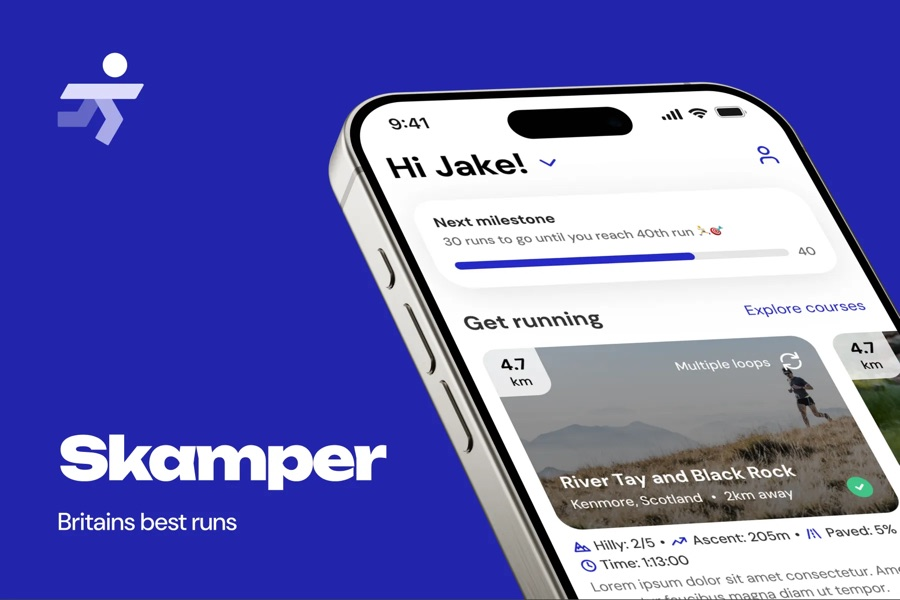</a>
 <code>RUNNING</code> &nbsp;<b>Tech Lead</b>
<h3><a href="https://codeleap.co.uk/portfolio/running-routes-races-app/">Skamper</a></h3>
UK running app with thousands of verified routes, on-demand races, leaderboards and GPS tracking.
</td>
<td width="50%" valign="top">
<a href="https://codeleap.co.uk/portfolio/self-guided-trail-holiday-app/">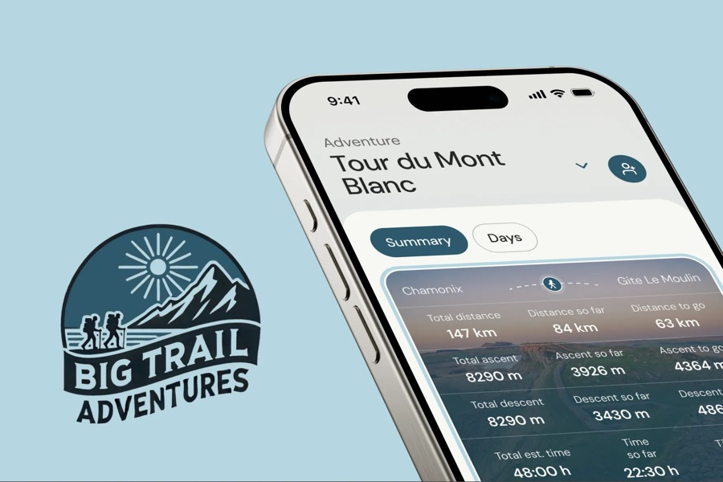</a>
 <code>WALKING HOLIDAYS</code> &nbsp;<b>Tech Lead</b>
<h3><a href="https://codeleap.co.uk/portfolio/self-guided-trail-holiday-app/">Big Trail Adventures</a></h3>
Self-guided walking holidays with offline GPS routes, maps and booked stays.
</td>
</tr>
</table>

<a href="https://codeleap.co.uk/team/kenzo/"><b>View all projects →</b></a>

<a href="https://yazo.com.br/">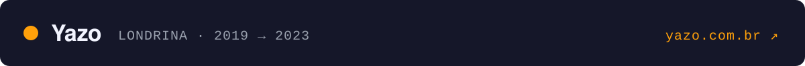</a>

Four years at [Yazo](https://yazo.com.br/), an event-tech company in Londrina, leading the frontend team while the company grew fast.

<table>
<tr>
<td width="50%" valign="top">
<a href="https://yazo.com.br/"></a>
 <code>VIRTUAL &amp; HYBRID EVENTS</code> &nbsp;<b>Frontend Tech Lead</b>
<h3><a href="https://yazo.com.br/">Yazo.online</a></h3>
Streaming platform for virtual and hybrid events, with broadcast rooms, virtual sponsor booths and networking rooms.
</td>
<td width="50%" valign="top">
<a href="https://yazo.com.br/app">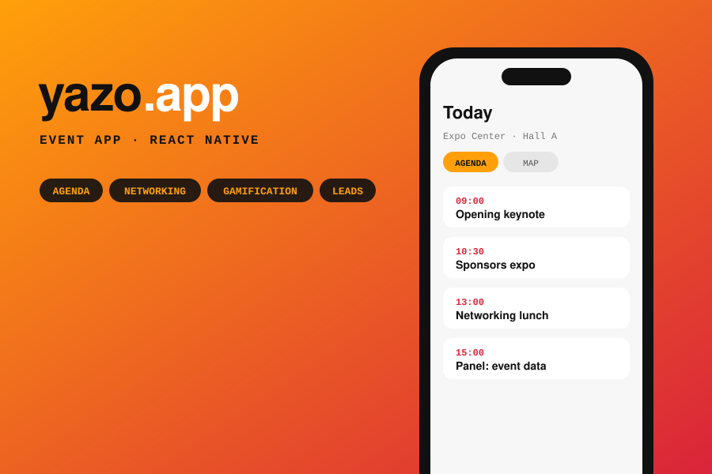</a>
 <code>EVENT APP</code> &nbsp;<b>React Native lead</b>
<h3><a href="https://yazo.com.br/app">Yazo.app</a></h3>
The event app in React Native, with agenda, map, networking, notifications and gamification.
</td>
</tr>
</table>

 

